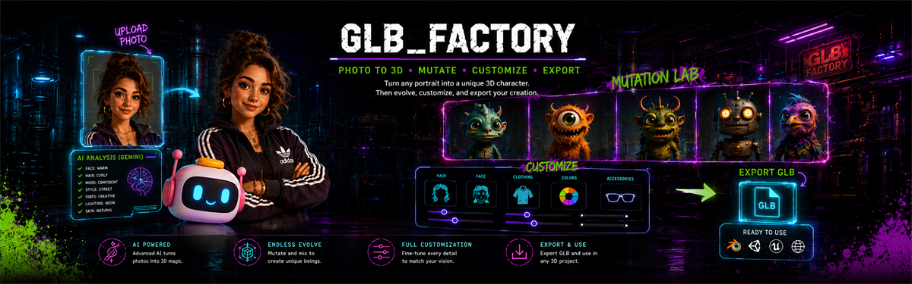
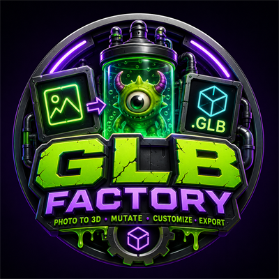
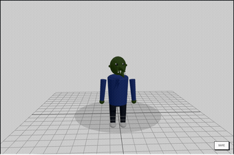
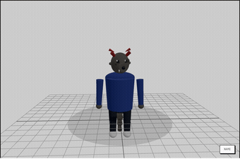
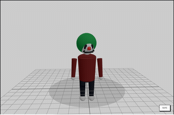
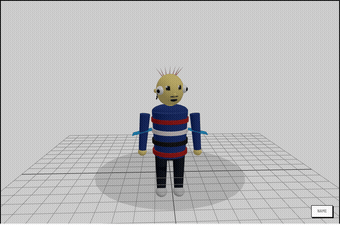

<p align="center">
  
</p>

<p align="center">
  
</p>

<p align="center">
  <a href="https://dacameragirl.github.io/GLB_FACTORY/"></a>
  
  
  
  
</p>

Upload a portrait — or spin up the Mutation Lab — and export a customizable, poseable **`.glb`** with PBR materials and an organized mesh hierarchy. Blocky, organic, or a full-on creature. GLB_FACTORY is a browser-based avatar studio with fitted portrait faces, procedural character bodies, and 22 articulated animal models.

**Two connected modes**

1. **Create From Photo** — Upload portrait → build avatar → customize → export GLB  
2. **Mutation Lab** — Generate specimens → collect rare mutations → breed two parents → export offspring

> **Export scope:** All 22 animal presets export real 3D geometry, PBR materials, an Idle clip, and a species movement clip. These clips animate articulated parts and play after GLB import. Human/fantasy walk and dance remain preview-only; these assets are not automatically compatible with humanoid retargeting rigs. Photo Sculpt exports a static textured mesh.

### 🎭 Live from the Mesh Style dropdown — actual in-app renders, not concept art

<table align="center">
<tr>
<td align="center"><br/><b>🐊 Alligator</b><br/><sub>animated chomping jaw</sub></td>
<td align="center"><br/><b>👹 Monster</b><br/><sub>warts &amp; fangs</sub></td>
<td align="center"><br/><b>🤡 Evil Clown</b><br/><sub>because someone asked</sub></td>
<td align="center"><br/><b>🦁🐟 Lionfish</b><br/><sub>venomous spike rays</sub></td>
</tr>
</table>

---

## Portrait face fitting

Upload a clear, front-facing portrait and choose **Fit Photo to 3D Face**. MediaPipe Face Landmarker runs in the browser and supplies normalized 3D landmarks. The first 468 points form a fitted facial surface with the original photo mapped to their UV coordinates. Nose, cheeks, lips, and jaw have real geometric relief. The exporter includes that geometry and texture.

This is an approximate single-image fit, not a scan or a full character reconstruction. Depth and hidden surfaces are estimated; the rear skull is constructed as a closed cap. Ears, clothing, and body remain templates. Hair is not reconstructed by the portrait pipeline. Human walk/dance previews do not export as animation clips. Use several reference views and manual refinement in Blender when a closer likeness is needed.

The fitted workflow runs on GitHub Pages without a backend or API key. Its pinned WASM runtime and model are served from `public/mediapipe/`. The image is processed locally; the upstream MediaPipe runtime includes performance/utilization telemetry. See [model sources, licenses, and privacy notes](public/mediapipe/README.md). A failed/no-face detection shows a visible error and leaves export disabled instead of reporting a completed face.

---

## 🧬 What you can build

| Category | Options |
|---|---|
| **Base mesh style** | Organic Humanoid, Rounded Cube (voxel), Classic Box (retro blocky) |
| **Creature mesh styles** | 🧌 Gremlin, 👹 Monster, 🐊 Alligator, 🦝 Raccoon, 🐱 Cat, 🐶 Dog, 🦎 Lizard, 🐀 Possum, 🐠 Tiger Fish, 🦁🐟 Lionfish, 🤡 Evil Clown — each with its own head geometry (jaws, masks, fins, spikes, floppy ears — not just a recolor) |
| **Individual creature parts** | Fins 🐟, Tail 🦎, Snout 🐽, Whiskers 🐱, Mushroom Cap 🍄 (mix onto any base mesh style) |
| **Gear** | Blaster 🔫, Knife 🗡️, Herb Pouch 🌿, plus Glasses, Wings, Horns, Crown, Halo, Cyber Visor, Cape |
| **Animal animation exports** | Idle plus Walk, Swim, Fly, Slither, Crawl, or Hop, depending on species. The preview and GLB use the same clips. |
| **Humanoid poses (in-viewer)** | Idle, Walk, Dance, Zombie, Spin, Ninja, or joint sliders — human/fantasy preview poses are not exported as clips. |
| **Snap Studio** | 3D particle lenses, big-head lens, VHS/Cyber/Sepia/Glitch color filters, custom caption overlay |
| **Mutation Lab** | One click generates a new proportional/palette variant, ranked from `COMMON` up to the elusive `CHAOTIC-DIVINE` |

### Animal collection

Choose an animal in **Parts → Mesh Style / Model Shape**. A photo is optional. Preview **Idle** or the movement button, then choose **Export Final GLB**. Animal anatomy is generated as geometry; a portrait does not replace its head. Human clothing and hair controls apply to humanoids.

The 22 animal models are: alligator, raccoon, cat, dog, lizard, possum, tiger fish, lionfish, dragon, hammerhead shark, twelve-arm octopus, spider, snake, bat, crow, rat, centipede, biped lizard, toad, scorpion, worm, and mantis. The twelve-arm octopus and dragon intentionally retain the game's fantasy designs.

Before/after captures render exported GLBs after re-import. The baseline exports contain no animations, so their comparison views are deliberately still. Improved views play embedded movement clips. These are stylized procedural models, not photorealistic reconstructions.

---

## ⚡ GitHub Pages Deployment

An automated GitHub Actions workflow (`.github/workflows/deploy.yml`) builds and publishes the app on every push to `main`.

To activate it on a fork: **Settings → Pages → Build and deployment → Source: GitHub Actions.** Progress shows under the **Actions** tab.

Keep the source set to **GitHub Actions**, not a branch folder: the root `index.html` is Vite source and cannot run directly on Pages. The deployment uses `npm run build:pages` to publish only the browser app and enable local photo analysis without an API server.

Regression checks: `npm run lint`, `npm test`, then `npm run build:pages` and `node scripts/photo-workflow-qa.mjs` and `node scripts/portrait-races-qa.mjs` (requires the Playwright Chromium browser). The browser check covers portrait upload, character and sculpt GLB downloads, exported skin joints, unreadable-image recovery, and direct selection/export of all 22 animals. `npm test` reloads every animal GLB and checks both clips actually move its parts.

---

## 🛠️ Local Development

**Prerequisites:** Node.js 18+, npm

```bash
npm install
npm run dev
```

Open [http://localhost:3000](http://localhost:3000).

Portrait fitting needs no API key. The legacy Express `/api/crop-face` endpoint remains available for existing integrations, but the portrait button uses the local landmark pipeline in both development and production.

---

## 🏗️ Technologies Used

- **Three.js** — WebGL rendering & procedural mesh construction
- **React 19 + Vite 6** — SPA runtime & build
- **Tailwind CSS v4** — utility-first styling
- **Lucide React** — icons
- **MediaPipe Tasks Vision** — locally processed facial landmarks; pinned model and WASM assets
- **Express + Google GenAI SDK** — legacy optional backend endpoint (not used by the portrait fitting workflow)

---

## 🏆 Highlights

1. **One-Click Procedural Chaos Mutation Lab** 🌀 — Tap **Mutate Skeletal DNA Now** for instant palette/proportion variants instead of manually rescaling hierarchies and repainting textures by hand. Tune the Chaos Regulator, or let the Chrono-Loop auto-cycle generations. Genomic rank flashes from `COMMON` to `CHAOTIC-DIVINE`.
2. **Live Client-Side Texture Blending** 🎨 — Drag a photo in; color harvesting and feather-edge facial blending onto the head texture happen live in-browser. (The UV coordinates themselves are a fixed projection computed at mesh-build time — what's live is the texture painted onto them, not the mapping itself.)
3. **Rig QA Drop & Squish Test** 🦘 — One click runs a stretch-and-squash stress check on the live rig, with 8-bit sound design.
4. **Instant 2D Style Overlays** 👾 — Retro CRT, Cyberpunk HUD, Blueprint, Pencil Sketch, or Gameboy dither, toggled live.
5. **Direct Bone Joint Controllers** 🦴 — Slide Head Yaw/Pitch, arm rotation, or leg kicks directly.
6. **Web Audio Soundboard** 🔊 — Real oscillator-driven 8-bit sound on rig actions, shutter clicks, and meltdowns.

---

<p align="center">
  <sub>Built by <a href="https://github.com/DaCameraGirl">DaCameraGirl</a> — bug reports and creature requests welcome.</sub>
</p>
